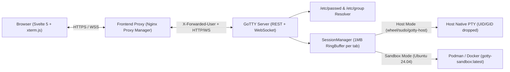

# Architecture & Internals

This project extends the original single-command GoTTY server with a session manager, `/etc/passwd` user resolution, container/host execution backends, file transfer handlers, and a local reverse proxy for web previews.

> [!IMPORTANT]
> GoTTY is not designed to run exposed to the internet on its own. It assumes an upstream reverse proxy (such as [Nginx Proxy Manager](https://nginxproxymanager.com/)) handles SSL/TLS termination and user authentication, forwarding the authenticated user identity over a local or internal network.

---

## 1. Multi-Session Lifecycle & `SessionManager`

In upstream GoTTY, closing or reloading the browser tab closes the WebSocket and terminates the child process. Here, sessions are tracked by [`SessionManager`](../server/session_manager.go):

- **Detached Persistence**: Sessions remain running on the server when all browser clients disconnect.
- **1MB Circular Ring Buffer**: Each session has a thread-safe 1MB [`CircularBuffer`](../server/ring_buffer.go) that stores recent PTY output. When a browser reconnects (or a second window attaches to the same `session_id`), the server writes the buffered output to the client before streaming live PTY data.
- **Multi-Client Attachment**: Multiple WebSocket clients can attach to the same `session_id` concurrently and receive the same output stream and resize events.
- **Idle Reap Timer**: When the last client detaches from a session, a timer starts based on the user's configured `reap_timeout` (`never`, `1h`, `2h`, `8h`, `24h` in `~/.gotty/config.yaml`). If a client reattaches before the timer expires, the timer is cancelled.

---

## 2. Execution Backends: `sandbox` vs. `host`

When a session is created via `POST /api/sessions`, [`ContainerSlave`](../server/container_backend.go) starts the process in one of two modes:

### Sandboxed Container (`sandbox` — Default)
- Runs an Ubuntu 24.04 container (`gotty-sandbox:latest`, built from [`Containerfile`](../Containerfile)) using Docker or Podman.
- Includes common CLI utilities (`build-essential`, `git`, `python3`, `python3-pip`, `python3-venv`, `curl`, `wget`, `jq`, `htop`, `iproute2`, `net-tools`, `nano`, `vim-tiny`, `sudo`).
- Executes under the user's host UID and GID (`-u <uid>:<gid>`) with `/home/<username>` bind-mounted (`-v /home/<user>:/home/<user>`) and `--security-opt label=disable` so the user can read and write their home directory without accessing the rest of the host filesystem.
- Users who are not members of `wheel`, `sudo`, or `gotty-host` (or the groups specified by `--host-groups`) are always placed in `sandbox` mode even if `host` mode is requested.

### Host Shell (`host`)
- Available only to users who belong to `wheel`, `sudo`, or `gotty-host` (or `UID 0`).
- Opens a native host PTY and drops process credentials via `syscall.Credential{Uid, Gid, Groups}` to the resolved Linux user account.
- Sets `HOME`, `USER`, `LOGNAME`, `SHELL`, and—if `/run/user/<uid>` exists—`XDG_RUNTIME_DIR` and `DBUS_SESSION_BUS_ADDRESS`.

---

## 3. File Transfers (`godl` & Multipart Upload)

### Browser Downloads via `godl` (OSC 7777)
The [`godl`](../cmd/godl/main.go) binary sends files from a terminal session to the browser over the existing terminal WebSocket using OSC 7777 escape sequences:

- **Single Frame (files ≤ 512KB)**:
  `\x1b]7777;download;filename=<base64>;size=<bytes>;data=<base64>\x07`
- **Chunked Frames (files > 512KB)**:
  `\x1b]7777;download;id=<hex>;chunk=<seq>;total=<n>;filename=<base64>;size=<bytes>;data=<base64>\x07`

In the browser, [`Osc7777Receiver`](../js/src/osc7777.ts) registers an xterm.js OSC `7777` handler, reassembles the chunks (up to 100MB, with a 60-second timeout for incomplete transfers), creates a `Blob`, and triggers a file download.

### File Uploads (`POST /api/sessions/:id/upload`)
Dragging files onto the terminal or using the top-bar upload button sends a `multipart/form-data` request (up to 512MB):

1. The server inspects `/proc/<pid>/cwd` of the session's shell process (checking active child processes first) to find the current working directory.
2. For sandboxed sessions, `isSafeUploadDir` verifies via `filepath.EvalSymlinks` that the directory is inside the user's home directory.
3. [`writeUploadedFileInDir`](../server/api_handlers.go) opens the target directory using Go's `os.OpenRoot` API and `O_NOFOLLOW` to prevent symlink or path traversal outside the target directory, writes the file, and sets ownership (`chown`) to the user's UID and GID.
4. If the shell working directory cannot be resolved or written to, the server writes the file to `/home/<username>/`.

---

## 4. Local Web Preview Proxy (`server/preview.go`)

[`PreviewManager`](../server/preview.go) provides an HTTP, HTTPS, and WebSocket reverse proxy for testing web services running on the remote machine:

- **Startup Interface Introspection**: When the server starts, `discoverPreviewEndpoints()` queries `net.Interfaces()` and records `localhost` (`127.0.0.1`) along with active non-loopback private IPv4 addresses (`10.0.0.0/8`, `172.16.0.0/12`, `192.168.0.0/16`, `100.64.0.0/10`).
- **Privilege Scoping**: Users with host access (`IsHostAccess == true`) can preview `localhost` or any local/private IP on the machine. Sandboxed users (`IsHostAccess == false`) only receive `localhost` in `GET /api/preview` and are blocked from proxying to non-loopback LAN addresses. External public IPs and link-local cloud metadata addresses (`169.254.169.254`) are rejected for all users.
- **Subresource Routing**: Requests to `/preview/[http|https/]<host>:<port>/...` set an `HttpOnly` cookie (`gotty_preview_target`). If a previewed application requests a root-relative path (such as `/assets/app.js`) that does not match a GoTTY route, `tryPreviewFallback` routes the request to the active preview target using the `Referer` header or the cookie.

---

## 5. Frontend Structure (`js/src/`)

The browser UI is built with Svelte 5, Vite, Tailwind CSS, and `@xterm/xterm`:
- [`App.svelte`](../js/src/App.svelte): Manages the list of open tabs, keyboard shortcuts (`Alt+T`, `Alt+W`), file upload input, and toast notifications.
- [`TopBar.svelte`](../js/src/components/TopBar.svelte), [`TabList.svelte`](../js/src/components/TabList.svelte), [`TabItem.svelte`](../js/src/components/TabItem.svelte), [`NewTabButton.svelte`](../js/src/components/NewTabButton.svelte): Renders the tab strip, inline tab renaming, and mode selection dropdown.
- [`PreviewButton.svelte`](../js/src/components/PreviewButton.svelte): Queries `/api/preview` for introspected interfaces and opens `./preview/<host>:<port>/` in a new tab.
- [`XtermInstance.svelte`](../js/src/components/XtermInstance.svelte): Mounts each tab's xterm.js instance, manages the WebSocket connection, handles drag-and-drop uploads, and wires clipboard shortcuts.
- [`SettingsDrawer.svelte`](../js/src/components/SettingsDrawer.svelte) & [`fonts.ts`](../js/src/fonts.ts): Reads and updates `~/.gotty/config.yaml` via `/api/user/config` and detects available monospace fonts.
