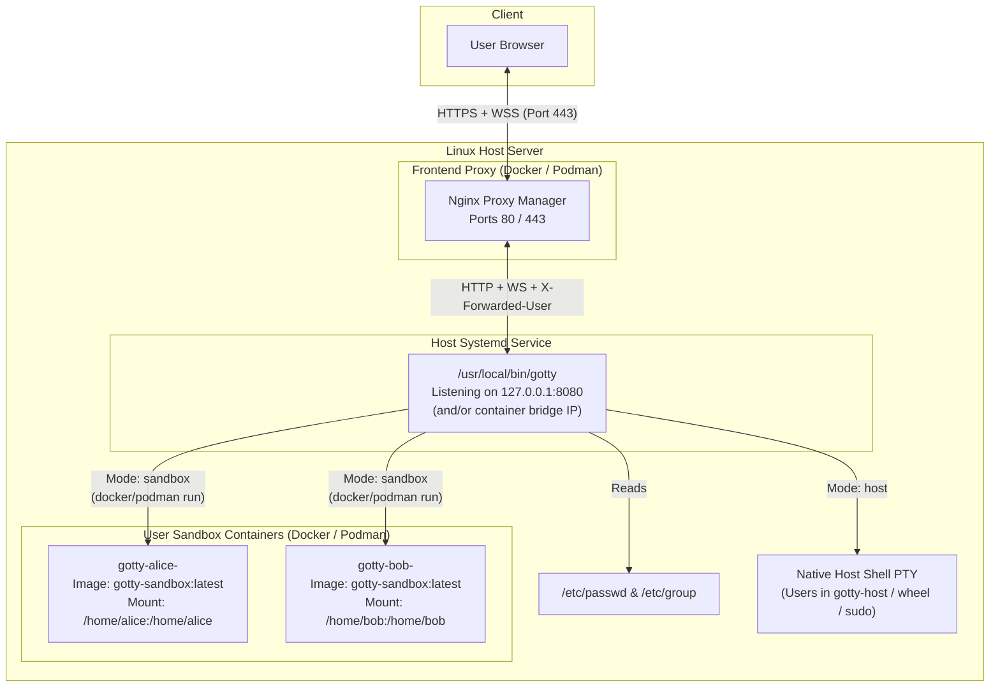

# End-to-End Deployment & Container Guide

This guide walks through deploying GoTTY from start to finish: building the binaries and the sandbox container image, provisioning Linux users and groups, configuring the systemd service, and placing [Nginx Proxy Manager (NPM)](https://nginxproxymanager.com/) in front of GoTTY for SSL termination and user authentication.

> [!IMPORTANT]
> **GoTTY is not intended to be exposed directly to the network on its own.**  
> Always deploy an authenticating reverse proxy (such as [Nginx Proxy Manager](https://nginxproxymanager.com/)) in front of GoTTY to handle HTTPS/TLS and user authentication.

---

## 1. Deployment Architecture



### Why `gotty` Runs on the Host (Systemd) While Spawning Containers
1. **Identity & Privilege Resolution**: `gotty` reads the host's `/etc/passwd` and `/etc/group` to resolve the `X-Forwarded-User` header into a real Linux UID, GID, home directory, and group list.
2. **Sandbox Container Spawning (`Containerfile`)**: When a user opens a `sandbox` tab, `gotty` runs `docker run` or `podman run` using the `gotty-sandbox:latest` image, passing `-u <uid>:<gid>` and bind-mounting only `/home/<username>:/home/<username>`.
3. **Host Shell Spawning**: When a privileged user (a member of `gotty-host`, `wheel`, or `sudo`) opens a `host` tab, `gotty` allocates a host PTY directly and drops privileges to that user's UID and GID.

*(Note: The repository also contains a [`Dockerfile`](../Dockerfile) inherited from upstream GoTTY for running a single standalone GoTTY binary inside an Alpine container, whereas [`Containerfile`](../Containerfile) defines the Ubuntu 24.04 user sandbox image used by the multi-session container backend.)*

---

## 2. Step-by-Step Installation

### Option A: Automated Setup (`./install.sh`)
Running [`./install.sh`](../install.sh) from the repository root performs steps 1–4 below automatically:
```bash
git clone https://github.com/mostlyrobots/gotty.git
cd gotty
chmod +x ./install.sh
./install.sh
```

### Option B: Manual Build & Container Setup

#### Step 1: Build the Frontend and Go Binaries
Requires Node.js (v20+) and Go (1.24+):
```bash
# 1. Build the Svelte 5 frontend into bindata/static/
cd js
npm install
npm run build
cd ..

# 2. Compile gotty (server) and godl (file download CLI)
CGO_ENABLED=0 go build -o gotty .
CGO_ENABLED=0 go build -o godl ./cmd/godl

# 3. Install both binaries to /usr/local/bin
sudo install -m 0755 gotty /usr/local/bin/gotty
sudo install -m 0755 godl /usr/local/bin/godl
```

#### Step 2: Build the `gotty-sandbox:latest` Container Image
[`Containerfile`](../Containerfile) builds an Ubuntu 24.04 environment for `sandbox` sessions. During the build it:
- Installs standard CLI and development packages (`build-essential`, `git`, `python3`, `python3-pip`, `python3-venv`, `curl`, `wget`, `jq`, `htop`, `iproute2`, `net-tools`, `dnsutils`, `nano`, `vim-tiny`, `sudo`, etc.).
- Removes the default `ubuntu` (UID 1000) user so arbitrary host UIDs/GIDs do not collide inside the container.
- Sets `/etc/passwd` and `/etc/group` permissions inside the container so dynamic UIDs can register an entry on shell startup.
- Configures passwordless `sudo` inside the isolated container sandbox.
- Copies the `godl` binary to `/usr/local/bin/godl` inside the image (`gotty` also bind-mounts `/usr/local/bin/godl:/usr/local/bin/godl:ro` at runtime if present on the host).

Build the image with **Docker** or **Podman**:
```bash
# Using Docker:
sudo docker build -t gotty-sandbox:latest -f Containerfile .

# Or using Podman:
sudo podman build -t gotty-sandbox:latest -f Containerfile .
```

> [!TIP]
> To add extra tools or packages for your users in sandbox mode, edit [`Containerfile`](../Containerfile) and re-run the `docker build` or `podman build` command above. New tabs will immediately use the updated `gotty-sandbox:latest` image.

---

## 3. Provisioning Linux Users & Groups

GoTTY matches the identity sent by the reverse proxy against `/etc/passwd` and checks `/etc/group` to decide whether the user is allowed to use `host` mode.

### 1. Create the `gotty-host` Group
```bash
sudo groupadd -f gotty-host
```

### 2. Provision a Sandboxed User (`sandbox` mode only)
A standard Linux user who is **not** in `gotty-host`, `wheel`, or `sudo` can only launch `sandbox` containers, and only their `/home/<username>` directory is mounted into the container:
```bash
# Create user with a home directory and /bin/bash shell, and set their email in the GECOS field:
sudo useradd -m -s /bin/bash -c "Alice Smith,alice@example.com" alice

# Or update the GECOS email on an existing user:
sudo usermod -c "Alice Smith,alice@example.com" alice
```

### 3. Provision a Host-Authorized User (`sandbox` and `host` modes)
Adding a user to `gotty-host` (or `wheel` / `sudo`) allows them to switch between `sandbox` containers and a direct `host` shell in the UI:
```bash
sudo useradd -m -s /bin/bash -c "Admin User,admin@example.com" adminuser
sudo usermod -aG gotty-host adminuser
```

---

## 4. Configuring the `gotty` Systemd Service

Create `/etc/systemd/system/gotty.service`:

```ini
[Unit]
Description=GoTTY Multi-Session Web Terminal
After=network.target docker.service

[Service]
Type=simple
User=root
ExecStart=/usr/local/bin/gotty \
  --address 127.0.0.1 \
  --port 8080 \
  --permit-write \
  --proxy-auth \
  --container-runtime docker \
  --container-image gotty-sandbox:latest \
  /bin/bash
Restart=always
RestartSec=3

[Install]
WantedBy=multi-user.target
```
*(If using Podman instead of Docker, replace `docker.service` with `podman.service` and `--container-runtime docker` with `--container-runtime podman`.)*

### Binding `--address` When Nginx Proxy Manager Runs in a Container
- **If NPM runs on the host network (`network_mode: host`)**: Keep `--address 127.0.0.1`.
- **If NPM runs in a bridged Docker or Podman container**: `127.0.0.1` inside the NPM container refers to the NPM container itself, not the host. Bind GoTTY to both `127.0.0.1` and your host's container bridge IP (for example, `docker0` or `podman0`):
  ```bash
  # Find your host's container bridge IP (for example 172.17.0.1 on docker0):
  ip -4 addr show
  ```
  Then pass both addresses separated by a comma in `ExecStart`:
  ```text
  --address 127.0.0.1,172.17.0.1
  ```

Enable and start the service:
```bash
sudo systemctl daemon-reload
sudo systemctl enable --now gotty
sudo systemctl status gotty
```

---

## 5. Deploying & Configuring [Nginx Proxy Manager (NPM)](https://nginxproxymanager.com/)

### 1. Example `docker-compose.yml` for Nginx Proxy Manager
If you do not already have [Nginx Proxy Manager](https://nginxproxymanager.com/) running, you can deploy it with Docker Compose:

```yaml
services:
  npm:
    image: 'jc21/nginx-proxy-manager:latest'
    restart: unless-stopped
    ports:
      - '80:80'
      - '81:81'
      - '443:443'
    volumes:
      - ./data:/data
      - ./letsencrypt:/etc/letsencrypt
```

Start NPM with `docker compose up -d` and open the admin UI on port `81`.

### 2. Create an Access List in NPM
1. In Nginx Proxy Manager, go to **Access Lists** → **Add Access List**.
2. Give it a name (e.g., `GoTTY Users`).
3. Under the **Authorization** tab, add the usernames (or emails) and passwords of your users.
   - Each username/email entered here will be placed into the Nginx `$remote_user` variable after authentication and must match either a Linux username or a GECOS email in `/etc/passwd` on the GoTTY host.
4. Click **Save**.

### 3. Create the Proxy Host in NPM
1. Go to **Hosts** → **Proxy Hosts** → **Add Proxy Host**.
2. **Details Tab**:
   - **Domain Names**: `terminal.example.com`
   - **Scheme**: `http`
   - **Forward Hostname / IP**: `127.0.0.1` (if NPM uses host networking) or the host bridge IP (e.g., `172.17.0.1`)
   - **Forward Port**: `8080`
   - **Block Common Exploits**: Enabled
   - **Websockets Support**: **Enabled** (Required for terminal streaming)
   - **Access List**: Select the `GoTTY Users` Access List created above
3. **SSL Tab**:
   - Select **Request a new SSL Certificate** (or choose an existing certificate).
   - Enable **Force SSL** and **HTTP/2 Support**.
4. **Advanced Tab**:
   Paste the following into **Custom Nginx Configuration** so NPM forwards the authenticated identity and host headers to GoTTY and permits large file uploads:
   ```nginx
   proxy_set_header Host $host;
   proxy_set_header X-Forwarded-Host $host;
   proxy_set_header X-Forwarded-Proto $scheme;
   proxy_set_header X-Forwarded-User $remote_user;
   client_max_body_size 512M;
   ```
   *(If you use Authelia, Authentik, or OAuth2 Proxy with NPM instead of an NPM Basic Auth Access List, ensure your auth snippet sets `X-Forwarded-User` or `X-Auth-Request-Email` from the upstream auth response.)*
5. Click **Save**.

---

## 6. Verifying the Deployment

### 1. Local Header Resolution Test
Before testing through the browser, you can verify that `gotty` resolves your `/etc/passwd` user on loopback:
```bash
# Should return 200 OK with a JSON array of sessions for alice:
curl -i -H "X-Forwarded-User: alice@example.com" http://127.0.0.1:8080/api/sessions

# Should return 403 Forbidden when no header or an unmapped user is sent:
curl -i http://127.0.0.1:8080/api/sessions
```

### 2. Inspect Active Sandbox Containers
Open `https://terminal.example.com` in your browser, log in through the proxy, and verify that a container was spawned for your session:
```bash
# Docker:
sudo docker ps --filter "name=gotty-"

# Podman:
sudo podman ps --filter "name=gotty-"
```
Each sandbox tab runs in a container named `gotty-<username>-<session_uuid>` and is automatically removed (`--rm`) when the tab is closed or reaped.

### 3. View Server Logs
```bash
sudo journalctl -u gotty -f
```
